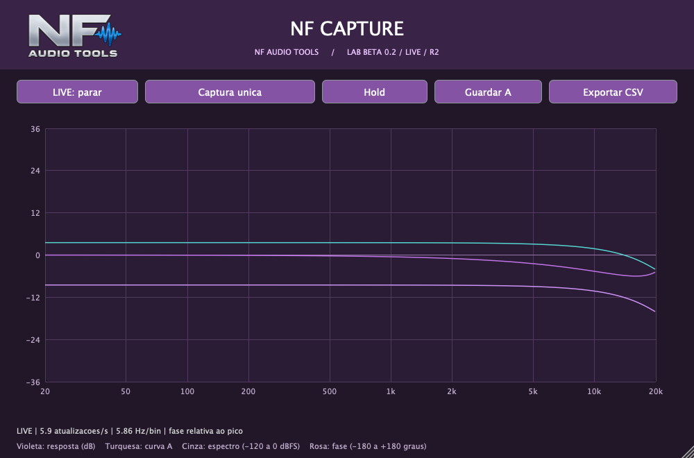
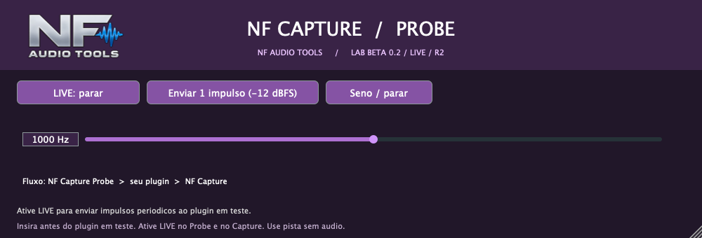

# NF Capture

Ferramenta NF Audio Tools para medir a resposta de frequência e fase relativa de plugins. Beta 0.2 LIVE, revisão R2.



## Recursos

- Capture e Probe em VST3 e AU para Mac Intel e Apple Silicon.
- Captura contínua LIVE para acompanhar os ajustes de um equalizador.
- Hold, comparação com curva A e exportação CSV.
- Captura única de alta resolução e gerador de seno.
- Interface roxa, títulos centralizados, alça de redimensionamento e restauração do tamanho padrão com dois cliques no logo NF.
- Estado LIVE preservado ao salvar e restaurar as instâncias.

## Usar na DAW

Em uma pista sem áudio, insira **NF Capture Probe → plugin em teste → NF Capture**. Com o transporte ativo, habilite LIVE nos dois componentes. Hold congela a leitura; Retomar volta a atualizá-la.

Leia o [guia completo](LEIA-ME.md) para instalação, medições, precisão e limitações. O canal medido é o esquerdo/mono. A fase é relativa; não há medição de latência absoluta nem reprodução da equalização capturada.

## Compilar no Mac

Requer Xcode, CMake 3.22+ e C++17. O JUCE 8.0.12 é incluído como submódulo fixado em um commit específico.

```sh
git clone --recurse-submodules https://github.com/nenofernando/NF-Capture.git
cd NF-Capture
cmake -S . -B build -DCMAKE_BUILD_TYPE=Release '-DCMAKE_OSX_ARCHITECTURES=x86_64;arm64'
cmake --build build --config Release -j 4
```

Os bundles são gerados nas pastas `build/NFCapture_artefacts/Release` e `build/NFProbe_artefacts/Release`.

## Validação

Testes internos cobrem resposta complexa de filtro conhecido, continuidade do gerador, atualização LIVE, Hold, restauração de estado e redimensionamento. Consulte [VALIDACAO.md](VALIDACAO.md). O funcionamento dentro da Mixa ainda precisa ser confirmado. A compilação Windows VST3 está prevista, mas não foi validada.



## Dependência e licença

O JUCE mantém sua licença própria no submódulo. A distribuição deve cumprir a modalidade de licença aplicável. Este repositório contém código-fonte e documentação; os plugins compilados não são versionados no Git.
