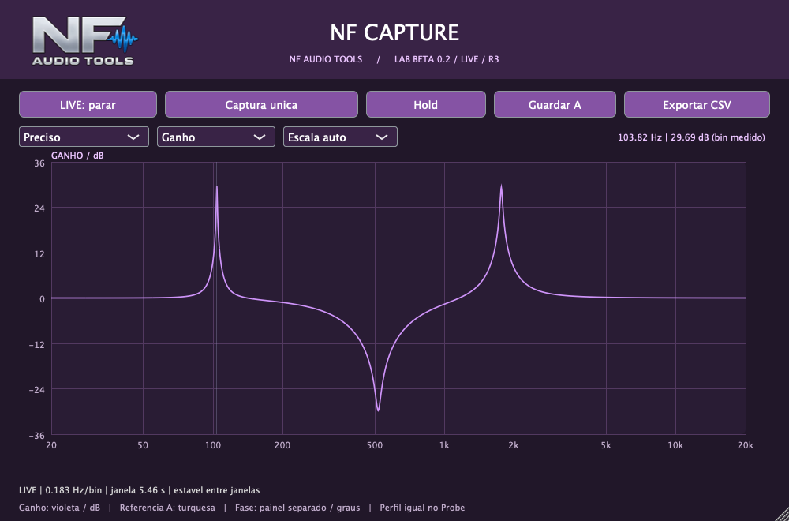
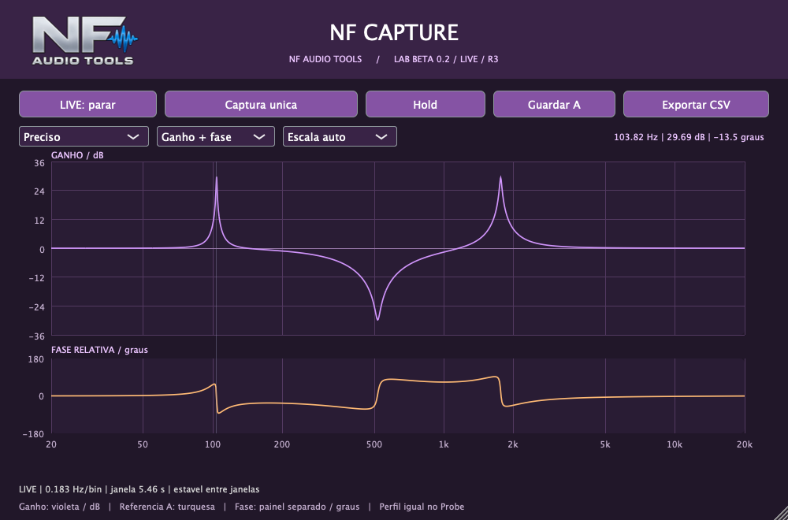

# NF Capture

Ferramenta NF Audio Tools para medir resposta de frequência e fase relativa de plugins. Beta 0.2 LIVE, revisão R3.



## O que mudou na R3

- Multisseno contínuo de aproximadamente -36 dBFS RMS para medir sem os longos silêncios entre impulsos.
- Perfis Rápido, Equilibrado e Preciso. Em 44,1 kHz: 5,383 / 0,673 / 0,168 Hz por bin.
- Janelas sobrepostas: o gráfico atualiza durante os ajustes, respeitando o tempo necessário para a medição estabilizar.
- Fase opcional em painel separado, com sua própria escala em graus. Ganho é a visualização padrão.
- Escala automática, cursor nos bins realmente medidos e desenho que preserva picos estreitos entre pixels.
- Indicações de preparação, transição, ausência de áudio e nível acima de 0 dBFS.
- Recuperação após interrupções ou perdas de amostras no buffer.

O detalhe adicional exige tempo: no perfil Preciso em 44,1 kHz, a janela mede aproximadamente 5,94 s. Não há garantia de exatidão absoluta. Veja os [resultados e limites da validação](VALIDACAO.md).

## Usar na DAW

Em uma pista sem áudio: **NF Capture Probe → plugin em teste → NF Capture**. Escolha o MESMO perfil no Probe e no Capture. Com o transporte ativo, habilite LIVE nos dois e aguarde a curva estabilizar.

Hold congela a leitura; Retomar continua. Guardar A mantém uma referência e Exportar CSV salva os pontos medidos. Atualize os dois componentes juntos: o sinal LIVE da R3 é diferente do da R2.

[Guia de instalação e uso](LEIA-ME.md).

## Interface e formatos

- Mac Intel e Apple Silicon, VST3 e AU.
- Interface roxa com títulos centralizados e alça de redimensionamento.
- Dois cliques no logo NF restauram o tamanho padrão.
- Estado LIVE e perfil salvos com as instâncias.
- Canal medido: esquerdo/mono. O áudio dos dois canais passa inalterado pelo analisador.



## Compilar no Mac

Requer Xcode, CMake 3.22+ e C++17. JUCE 8.0.12 é um submódulo fixado em commit específico.

```sh
git clone --recurse-submodules https://github.com/nenofernando/NF-Capture.git
cd NF-Capture
cmake -S . -B build -DCMAKE_BUILD_TYPE=Release '-DCMAKE_OSX_ARCHITECTURES=x86_64;arm64'
cmake --build build --config Release -j 4
```

Os bundles são gerados em `build/NFCapture_artefacts/Release` e `build/NFProbe_artefacts/Release`. NFVerify e NFVerifyProbe executam os testes internos.

## Limites

Ainda requer confirmação desta revisão dentro da Mixa. Windows VST3 não foi compilado ou validado. Não mede latência absoluta, THD, compressão ou saturação de forma equivalente a uma curva de EQ. Não reproduz a equalização capturada nem oferece captura calibrada de hardware.

O JUCE mantém sua própria licença no submódulo. A distribuição deve cumprir a licença aplicável. Este repositório contém código-fonte, imagens e documentação; os plugins compilados não são versionados no Git.
