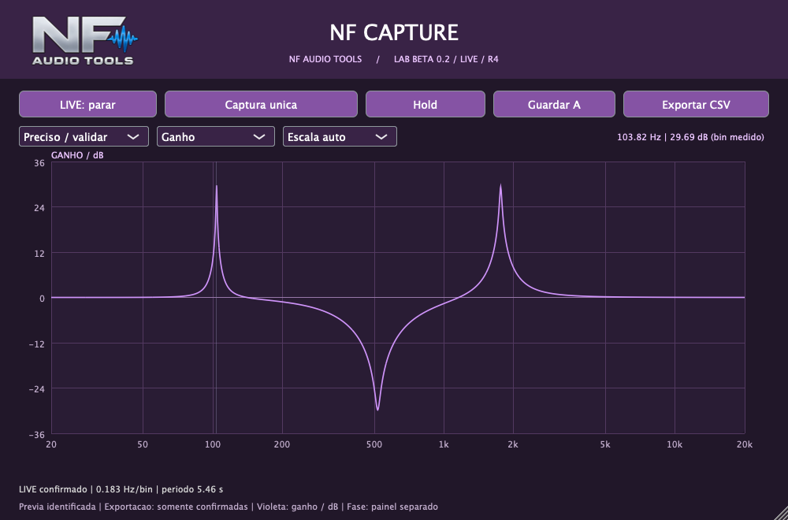

# NF Capture — LIVE R4

NF Audio Tools. Analisador de resposta de frequência e fase relativa para plugins. VST3 e AU universais para Mac Intel / Apple Silicon.



## Correção da R3

O LIVE usa impulsos periódicos isolados, em períodos completos, em vez de janelas sobrepostas de multisseno. Isso evita o método que gerava serrilhado ao misturar posições diferentes dos knobs.

Respostas curtas podem aparecer como **prévia identificada**, para acompanhar ajustes. A confirmação exige duas aquisições consecutivas compatíveis. Aquisições instáveis não substituem os dados confirmados nem podem ser exportadas. Para respostas longas sem prévia apropriada, o gráfico mantém explicitamente a última curva confirmada.

Não há suavização dos bins para ocultar erros. A confirmação é um teste de repetibilidade, não uma prova de linearidade ou exatidão absoluta.

## Uso

Em uma pista sem áudio: **NF Capture Probe → plugin em teste → NF Capture**. Escolha o mesmo perfil nos dois e ative LIVE com o transporte da DAW ativo.

- **Rapido / ajustar**: para mexer nos knobs. Em 44,1 kHz, período de 0,186 s e primeira confirmação em pelo menos aproximadamente 0,372 s.
- **Preciso / validar**: para conferir picos estreitos com os controles parados. Em 44,1 kHz, 0,168 Hz/bin e pelo menos aproximadamente 11,9 s para a primeira confirmação.
- Hold congela a última curva confirmada. Guardar A e CSV usam dados confirmados, separados da prévia.

Atualize Capture e Probe juntos. O sinal LIVE mudou novamente na R4. O sinal de teste pode ser audível: são impulsos de -30,1 dBFS de pico, não um chiado contínuo.

## Instalação e interface

O instalador macOS .pkg é distribuído separadamente e está configurado para a Library do usuário atual, substituindo os quatro bundles VST3/AU. Não contém scripts. Os plugins têm assinatura ad-hoc; o instalador não tem Developer ID Installer nem notarização Apple.

A interface mantém o tema roxo, títulos centralizados, alça de redimensionamento e restauração do tamanho padrão com dois cliques no logo NF. Ganho e fase usam painéis e unidades separados.

[Guia completo](LEIA-ME.md) · [Testes e limites](VALIDACAO.md)

## Compilar no Mac

Requer Xcode, CMake 3.22+, C++17 e JUCE 8.0.12, fixado como submódulo.

```sh
git clone --recurse-submodules https://github.com/nenofernando/NF-Capture.git
cd NF-Capture
cmake -S . -B build -DCMAKE_BUILD_TYPE=Release '-DCMAKE_OSX_ARCHITECTURES=x86_64;arm64'
cmake --build build --config Release -j 4
```

Bundles em `build/NFCapture_artefacts/Release` e `build/NFProbe_artefacts/Release`. NFVerify e NFVerifyProbe verificam respostas estáticas, alterações de parâmetros, rejeição de transições, retomada e interface.

## Limites

Esta revisão ainda precisa de confirmação dentro da Mixa. Os testes de movimento usam filtros sintéticos, não o binário NF Q Dynamics. Mede canal esquerdo/mono, com fase relativa. Não mede latência absoluta ou THD, não identifica integralmente saturação/compressores/modulação, não reproduz a curva capturada e ainda não tem captura calibrada de hardware. Windows não foi compilado.

A revisão R4 é identificada na interface; os bundles ainda usam versão 0.2.0. O recibo do instalador é 0.2.4. O JUCE mantém a própria licença no submódulo. Binários não são versionados neste repositório.
